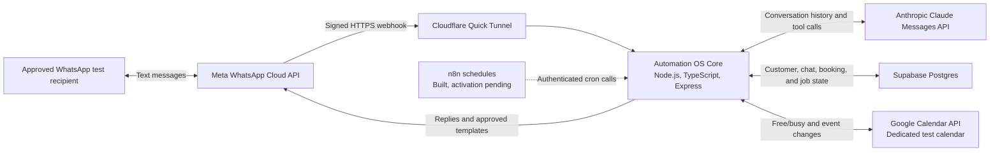

# Meridian WhatsApp receptionist technical specification

**System:** Catalyst 7 Automation OS v0.1.0  
**Demo:** Meridian Physiotherapy, a fictional single-practitioner practice in Pretoria  
**Status checked:** 18 November 2026, Africa/Johannesburg

The demo lets an approved test recipient ask about the practice, check appointment times, book, reschedule, and cancel in WhatsApp. The Core checks the dedicated Google Calendar before making a booking change and stores the corresponding record in Supabase. A customer receives a booking reference and can manage the appointment by describing it in the same chat.

## 1. Demo status

| Capability | Evidence and current state |
| --- | --- |
| WhatsApp booking, calendar event, cancellation, and slot reopening | Verified live with fictional booking `C7-GV6C`. Supabase and Google Calendar agreed. |
| Reference-free postponement and cancellation | Verified live with `C7-PKXO`. The customer moved the appointment from 10:00 to 14:00 SAST and cancelled it in WhatsApp. The reference stayed the same and both slots reopened. |
| Context correction for explicit old and new times | Verified live with `C7-BYWI`. The request moved the existing appointment from 10:00 to 14:00 SAST on 19 November, preserving the reference and Calendar event ID. The later pilot reset cancelled this fictional record. |
| Outbound WhatsApp permissions | Meta accepted a test reply with the 60-day system-user token after the pilot asset permissions were assigned. |
| Reminder and follow-up | Both jobs passed software tests and the accelerated preview. Meta now reports both English utility templates as **Approved**. Live delivery and recurring jobs remain unverified. At this check the scheduling credential was unset and Supabase contained no reminder or follow-up run records. |
| Public pilot endpoint | Meta still has the verified callback and subscribes to `messages`. Its temporary Cloudflare hostname failed DNS resolution at the status check. Restore the tunnel and update the callback for the next live demonstration. Stable hosting is pending. |

The booking and notification demo landed in local commit `92eb847` on `codex/meridian-booking-pilot`. The later context correction was present in the working tree when this specification was written.

## 2. Architecture

The Windows pilot starts the Core with `npm start` or `npm run dev` on port 3000 by default. The repository also includes a Node.js 20 container definition. Supabase, Google Calendar, and WhatsApp are selected through environment configuration. The terminal harness uses in-memory adapters for isolated trials. n8n supplies the schedule for notification jobs, while Meta delivers inbound messages directly to Express through the tunnel.

## 3. WhatsApp message flow

1. Meta validates `GET /webhook` with `hub.mode=subscribe` and the configured verify token. The Core echoes `hub.challenge` when validation succeeds.
2. For `POST /webhook`, Express captures the exact request bytes. The Core computes the HMAC-SHA256 using the app secret and compares it to `X-Hub-Signature-256`. It returns `401` for an invalid signature and acknowledges a valid request with `200` before processing.
3. The parser reads the first text message in the first webhook change. The Core filters the configured sending number, maps the Meta phone-number ID to a business and claims the provider message ID in Supabase for deduplication.
4. The handler loads the business config and practitioner pack. It looks up or creates the customer by business and sender number, then loads the open conversation and its stored user and assistant turns.
5. The latest worktree uses direct handlers for specific clear requests and Claude Haiku 4.5 for conversational interpretation and clarification. The model gets the practice facts and tool descriptions. Tool calls perform the actual reads and writes. Recognised change requests keep their intent across clarification turns and limit available write actions to the relevant cancellation or reschedule.
6. The Core saves the assistant reply and sends it with the Meta Graph API. The channel adapter currently targets Graph API `v21.0`. Meta acceptance and receipt on the handset are separate checks.

The customer can ask about hours, services, prices, parking, referrals, or medical-aid policy using the configured practice facts. The assistant is intended for reception and booking administration. Clinical questions are referred to the practitioner.

## 4. Booking rules and tool contracts

The practitioner pack uses a single booking resource. Meridian operates Monday to Friday from 08:00 to 17:00 and Saturday from 08:00 to 12:00 SAST. It is closed on Sunday. The current configuration uses a 30-minute start grid, a two-hour minimum lead time, a 21-day booking horizon, and a 24-hour reminder window. The booking engine converts practice-local date and time into an instant for Calendar and Supabase.

| Fictional service | Duration | Price |
| --- | ---: | ---: |
| Initial consultation | 45 minutes | R650 |
| Follow-up session | 30 minutes | R450 |
| Sports massage | 45 minutes | R500 |
| Dry needling add-on | 15 minutes | R150 |

| Tool | Inputs and effect |
| --- | --- |
| `check_availability` | Accepts a local date. Reads Calendar free/busy and returns eligible local start times. |
| `book_appointment` | Uses name, service, date and time. Rechecks the slot, creates the Calendar event with the configured service duration, then saves a confirmed appointment with its event ID and a `C7-XXXX` reference. |
| `list_upcoming_bookings` | Reads confirmed upcoming bookings scoped to the current business and WhatsApp customer. Returns appointment details and references for selection. |
| `reschedule_appointment` | Uses a new local date and time and an optional reference. Checks target availability and moves the linked event in place when an event ID is present. It updates the same booking row, retains the reference, and clears notification stamps. It attempts to reverse the Calendar change if the database update fails. |
| `cancel_appointment` | Uses an optional reference. Cancels the linked Calendar event and marks the Supabase record `cancelled`. The pilot clears the event title before deleting the event from its dedicated calendar. |

Without a reference, the bot uses the sender's existing bookings. If several match, it asks for a date or time to identify the appointment. A supplied reference is checked against the sender's customer ID. The 10:00 to 14:00 demo request uses the original start time to identify the appointment and keeps the same day when the match is unique.

## 5. Data, access, and retention

| Supabase table | Purpose |
| --- | --- |
| `businesses` | Tenant configuration under a business slug. The pilot reads Meridian's seeded config with the test phone-number route. The checked-in JSON is a fallback with a placeholder number ID. |
| `customers` | Customer identity scoped to a business and WhatsApp number, with optional name and last-seen information. |
| `conversations`, `messages` | Open or closed chat and its turns. Closing the conversation gives the next message a fresh context while preserving earlier messages for the retention period. |
| `engagements` | Appointment type, service, start, duration, status, customer, reference, Calendar event ID, and notification timestamps. |
| `processed_messages` | Provider message IDs used for inbound deduplication. |
| `cron_runs` | Execution time and sent, skipped, and failed counts for scheduled jobs. |

The Core accesses Supabase from the server with a service credential. The schema enables row-level security and restricts public table access. Calendar uses a Google service account with access to the dedicated test calendar. Configuration and credentials live in environment variables. Local secrets are kept in the ignored `.env` and outside this specification.

The pilot notice sets a 30-day retention period. The Supabase `pg_cron` definition runs every 15 minutes and expires Meridian records using a 720-hour cutoff. It queues opaque Calendar event IDs for the separate `npm run retention:calendar` job, which completes Calendar cleanup and leaves failed items queued for retry. This job was previously tested from Windows Task Scheduler. The privacy notice is served at `/privacy/meridian-booking-pilot`.

- [Schema and access controls](../src/db/schema.sql)
- [Meridian retention SQL](../src/db/meridian-retention.sql) and [Calendar cleanup job](../src/retentionCalendar.ts)
- [Pilot privacy notice source](../public/privacy/meridian-booking-pilot.html)

## 6. Interfaces and scheduled messaging

| Interface | Access and result |
| --- | --- |
| `GET /healthz` | Public liveness probe returning `{"ok":true}` while Express is reachable. |
| `GET /webhook` | Meta verify token. Returns the challenge on success and `403` on failure. |
| `POST /webhook` | Meta HMAC signature. Early acknowledgement, then processing and WhatsApp reply. |
| `POST /cron/reminders` and `POST /cron/followup` | Require `X-C7-Secret`. Return sent, skipped, and failed counts. |
| `POST /cron/reactivation` and `POST /cron/waitlist` | Same authentication. These jobs exist in the Core. Live operation is outside the verified Meridian demo. |
| `GET /ops/summary` | Requires `X-C7-Secret`. Returns the most recent 50 recorded scheduled runs. |
| `GET /privacy/meridian-booking-pilot` | Public HTML privacy notice for the pilot. |

| Template | Schedule in workflow definition | Selection and delivery |
| --- | --- | --- |
| `appointment_reminder` | Hourly | Confirmed future appointments inside Meridian's reminder window with no reminder stamp. Meta parameters are name, service, local date, and local time. |
| `appointment_followup` | Daily at 09:00 SAST | Confirmed or completed appointments whose end time has passed and whose follow-up stamp is empty. Meta parameters are name and service. |

The jobs use Meta-approved English utility templates and stamp a row after send acceptance. Repeated sequential runs skip already-stamped rows. The accelerated demo runs the actual job functions with a simulated clock and a single fictional in-memory appointment. The WhatsApp variant requires the Meta test sender, an approved recipient in `MERIDIAN_DEMO_RECIPIENT`, and the approved templates.

## 7. Setup and verification

| Integration | Configuration |
| --- | --- |
| Core and model | `PORT`, `DEFAULT_CLIENT_SLUG`, `ANTHROPIC_API_KEY`, `CLAUDE_MODEL`, `MAX_TOOL_ROUNDS` |
| Supabase | `SUPABASE_URL`, `SUPABASE_SERVICE_KEY` |
| Google Calendar | `GOOGLE_CALENDAR_ID` and either `GOOGLE_APPLICATION_CREDENTIALS` or `GOOGLE_SERVICE_ACCOUNT_JSON`. Set `MERIDIAN_RETENTION_CALENDAR_ID` to the same dedicated pilot calendar for cleanup. |
| Meta | `WHATSAPP_TOKEN`, `WHATSAPP_PHONE_NUMBER_ID`, `WHATSAPP_VERIFY_TOKEN`, `WHATSAPP_APP_SECRET`. Use the pilot app, test number, and approved recipient. The system user needs sending permission on the test assets. |
| Scheduled calls | `N8N_WEBHOOK_SECRET` in the Core, the matching `X-C7-Secret` credential in n8n, and `CORE_BASE_URL` pointed at the active host. |

| Command | Purpose |
| --- | --- |
| `npm run typecheck` | Validate the TypeScript build. |
| `npm run test:routing` and `npm run test:lifecycle` | Check tenant routing and booking lifecycle against the test adapters. |
| `npm run test:conversations` | Run fictional assistant conversations through Claude and the in-memory booking adapters. |
| `npm run test:booking-integration` | Create a fictional appointment in the configured test calendar and database, verify it moves, then cancel it and check the slot reopens. |
| `npm run test:reminders` | Exercise reminder selection and sequential repeat-run suppression. |
| `npm run demo:notifications` | Preview the reminder and follow-up within seconds. |
| `npm run demo:notifications -- --whatsapp` | Send the accelerated demo messages to the approved test recipient. |
| `npm run check:env` | Check deployment configuration is present before go-live. Verify provider access independently. |

For the live demo, check HTTPS health and the privacy route, verify Meta's callback, then send a message from the approved recipient. Book a fictional appointment, show its Calendar event, move it in WhatsApp, and confirm the same event and reference moved. Cancel it and recheck availability. For reminders and follow-ups, confirm receipt on the test handset first, then activate the recurring workflows and check their send counts and stamps.

## 8. Pilot boundaries and production work

- The pilot uses one outbound WhatsApp number and one configured Google Calendar. The current Meta test number serves approved recipients. A public demo needs a dedicated demo number and a stable HTTPS host.
- Availability currently tests whether a candidate start is inside a busy block. The production booking guard needs to validate overlap for the full service duration, closing-time boundaries, and concurrent writes.
- Calendar and Supabase use separate APIs. The webhook acknowledges requests before processing, and the provider message ID is claimed before handling. Failed work after acknowledgement needs explicit recovery in production. The prototype has no durable reply outbox or delivery-status tracking.
- Sequential job runs use send timestamps for duplicate suppression. Overlapping workers and failures between Meta acceptance and the timestamp update need stronger protection before production use.
- The pilot proves receptionist workflows with fictional details. Live customer rollout also requires the practice's data, account access, operational sign-off, and its published privacy notice.

See the [go-live runbook](GO-LIVE.md), [Core server](../src/server.ts), [practitioner pack](../verticals/practitioner/pack.json), and [n8n workflow inventory](../n8n/README.md).
